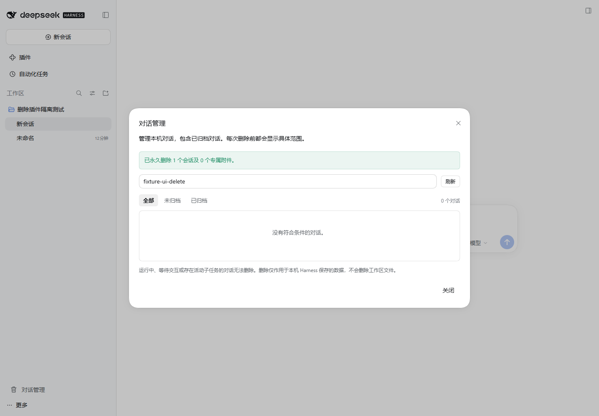

# DeepSeek Harness 本机对话永久删除插件

为 DeepSeek Harness 桌面版提供独立的 **对话管理** 面板，支持搜索普通、未分组和已归档对话，并在核对范围后永久删除本机记录及专属上传附件。

**当前版本：1.0.0｜已验证宿主：Windows 桌面版 DeepSeek Harness 0.2.1-rc.2。**

> 删除直接作用于本机保存的数据，不经过回收站。执行前必须查看预览并勾选确认；独立分叉和共享附件会保留。

## 功能

- 按标题、工作区或对话 ID 搜索，筛选全部、未归档和已归档对话。
- 删除主对话及其专属子代理、递归子代理，保留用户独立分叉的对话。
- 清理目标全部历史格式日志、工作区关联、置顶与归档标记、投影缓存和查询索引。
- 回收确认未被其他对话引用的上传图片、文件及其本地上传映射。
- 阻止删除正在运行、等待交互、存在待处理消息或活动任务的对话。
- 确认时重新检查对话状态与附件引用，状态变化后要求重新预览。
- 清理失败后可重试；已确认但未完成的操作会在重启后继续处理。

下图使用隔离环境中专门创建的测试数据：



## 兼容范围

| 项目 | 当前支持情况 |
| --- | --- |
| 宿主 | DeepSeek Harness **0.2.1-rc.2** |
| 客户端 | Windows 桌面客户端，`desktop` profile |
| 会话存储 | 宿主自带的本地 JSONL / Zstandard 存储 |
| 开发环境 | 推荐 Node.js 24，需要原生 Zstandard 支持 |

宿主尚未提供公开的完整删除接口，因此本插件包含针对该版本的适配。版本或必要接口不匹配时会停用删除并说明原因。其他宿主版本、独立 Web profile 和其他操作系统未作为本次发布的支持范围；升级 Harness 后应重新适配和验证。

## 安装

### 从 GitHub 安装

在 PowerShell 中使用 **桌面程序自带的启动器**：

```powershell
$dsh = Join-Path $env:LOCALAPPDATA 'Programs\DeepSeek Harness\resources\runtime\cli\bin\dsh.cmd'
& $dsh plugin --profile desktop add 'github:ZhangNanNan1018/dsh-local-session-delete'
```

仓库包含 `lib/` 构建产物，插件安装器可直接加载。安装后通过应用菜单正常退出，再重新打开桌面客户端。

如桌面程序安装在自定义位置，请将 `$dsh` 改为相应目录下的 `resources\runtime\cli\bin\dsh.cmd`。旧源码仓库或其他版本的全局 `dsh` 可能无法管理桌面 profile。

### 从源码安装或开发

```powershell
$pluginRoot = Join-Path $env:USERPROFILE '.dsh\local-plugins\dsh-local-session-delete'
git clone https://github.com/ZhangNanNan1018/dsh-local-session-delete.git $pluginRoot
Set-Location $pluginRoot

npm ci --legacy-peer-deps
npm run build
npm run check
npm test

$dsh = Join-Path $env:LOCALAPPDATA 'Programs\DeepSeek Harness\resources\runtime\cli\bin\dsh.cmd'
$pluginLink = 'link:' + ((Get-Location).Path -replace '\\', '/')
& $dsh plugin --profile desktop add $pluginLink
```

如果目标目录已有源码，直接进入该目录更新、构建即可，不要再次克隆覆盖。核心框架依赖由桌面运行时提供，`--legacy-peer-deps` 用于避免在独立源码目录中额外安装一份宿主框架。

### 从本地安装包安装

在源码目录生成并安装包含构建产物的安装包：

```powershell
npm run build
npm pack
& $dsh plugin --profile desktop add (Join-Path (Get-Location) 'dsh-local-session-delete-1.0.0.tgz')
```

`$dsh` 的设置方式见上文。安装包不需要在安装时执行源码构建。

## 使用

1. 点击客户端左下角的 **对话管理**。
2. 搜索目标，或切换到 **未归档 / 已归档** 筛选。
3. 点击目标旁的 **删除**，查看主对话、子代理及专属附件的影响范围。
4. 核对范围，勾选确认后点击 **永久删除**。
5. 等待成功提示。删除当前打开的对话时，界面会切回空白会话并刷新列表。

安装后第一次正常重启很重要：插件需要取得宿主创建、恢复对话时提供的完整关闭句柄。无法取得句柄的已打开对话会被阻止删除，并提示重启后再试。

## 删除范围

| 数据 | 处理方式 |
| --- | --- |
| 所选主对话及其专属子代理 | 删除全部历史格式日志 |
| 用户独立分叉及分叉中的历史副本 | 保留 |
| 对话的工作区关联、置顶和归档标记 | 移除目标条目 |
| 投影缓存、查询缓存和已启用的全文索引 | 清理目标条目及可识别的遗留缓存 |
| 仅由目标引用的上传图片、文件 | 回收本机保存的副本 |
| 被其他对话、历史日志或待提交上传引用的附件 | 保留 |
| 项目原文件、工作区目录和外部导出 | 保留 |
| 服务商已经接收的数据和远程上传 | 不在本机删除范围内 |

图片请求缓存是共享、可重建的派生缓存。回收专属图片时，插件会等待正在进行的转换完成，再清空该缓存；保留对话按需重新生成，不影响其原图。

## 删除保护与失败恢复

- **先预览后确认**：删除令牌绑定检查时的对话状态和附件引用，不能跳过预览直接执行。
- **先关闭后清理**：阻止目标继续发送消息、重新打开或创建子代理，等待完整关闭和持久化写入结束后再删除文件。
- **共享引用检查**：检查保留对话的各代日志、实时消息和待提交上传；遇到损坏、未被识别的日志或异常路径时停止删除。
- **路径核验**：不沿符号链接或目录联接删除数据，不接受越界路径。
- **可恢复的清理操作**：操作记录保存在 Harness 数据目录的 `local-session-delete/pending/` 下，仅包含 ID、路径、附件引用和执行阶段，不保存聊天正文。

这里的“恢复”是继续完成已经确认的删除，不是恢复已删除的聊天。插件不创建对话回收站或日志备份。若提示 **清理未完成**，在面板中重新预览并重试；重启后也会继续处理。未完成清理前应保留插件与操作记录。

## 常见问题

| 提示或现象 | 处理方式 |
| --- | --- |
| 当前版本不受支持 | 核对宿主版本，使用经过适配的插件版本，不要绕过兼容性检查 |
| 正在运行、等待交互或存在活动任务 | 先停止或完成对应任务；有启用中的定时任务时先停用 |
| 请重启后再删除此对话 | 正常退出整个桌面程序后重新打开 |
| 对话或附件引用已变化 | 重新预览，核对新的删除范围 |
| 日志损坏、无法证明附件未共享 | 保留原数据并检查日志或路径异常，插件不会猜测共享关系 |
| 文件占用或清理未完成 | 解除外部占用后在管理面板中重试 |
| 安装后没有“对话管理”入口 | 检查插件是否启用，并正常重启桌面客户端 |

若第三方插件加载错误导致客户端无法启动，可使用下方卸载命令只移除本插件后重启，并保留宿主提供的诊断日志用于排查。

## 卸载

```powershell
$dsh = Join-Path $env:LOCALAPPDATA 'Programs\DeepSeek Harness\resources\runtime\cli\bin\dsh.cmd'
& $dsh plugin --profile desktop remove dsh-local-session-delete
```

卸载后正常重启。卸载不能恢复已删除对话，也不应在清理尚未完成时删除操作记录。

## 开发与验证

```powershell
npm ci --legacy-peer-deps
npm run build
npm run check
npm test
```

先构建再测试：客户端测试会读取 `lib/client.js`，这样才能验证与当前源码一致的产物。仓库同时保留源码和构建产物；修改源码后应重新构建并一并提交相应产物。

| 位置 | 职责 |
| --- | --- |
| `src/adapter.js` | 固定宿主版本适配、完整生命周期、日志与附件引用检查 |
| `src/service.js` | 列表、预览令牌、删除编排和中断恢复 |
| `src/files.js` | 路径核验、日志和附件清理、操作记录 |
| `src/wire.js` / `src/index.js` | 严格接口契约与仅拥有者可调用的宿主服务 |
| `src/client.jsx` / `src/styles.css` | 对话管理界面 |
| `test/` | 临时数据、并发、异常路径和界面行为测试 |

当前包含 **42 项自动测试**，覆盖子代理与分叉边界、共享附件、多段压缩日志、路径保护、Windows 文件占用、过期预览和中断重试等场景。测试仅在专用临时目录中创建和删除数据。

已在相同的已安装宿主运行时中验证权限、实际删除、索引清理与重启后不恢复；也在真实浏览器中完成了搜索、预览、勾选确认、删除和成功提示的完整流程。这些集成验证使用隔离测试数据，未删除用户既有对话，不属于 `npm test` 自动启动的集成环境。

### 接口

以下方法均仅允许宿主认定的拥有者调用，不注册模型可调用的删除工具：

| 方法 | 用途 |
| --- | --- |
| `sessionDelete/list` | 获取兼容状态与主对话列表 |
| `sessionDelete/preview` | 检查目标范围，返回状态及确认令牌 |
| `sessionDelete/remove` | 使用对话 ID 和有效预览令牌执行确认删除 |
| `sessionDelete/deleteConfirmed` | 浏览器调用同一删除实现的安全别名 |

浏览器框架将 `remove` 用作内部方法名，因此客户端仅挂载 `list`、`preview` 和 `deleteConfirmed`；宿主保留原 `remove` 接口。

## 许可证与参考

本插件使用 [MIT 许可证](LICENSE)。第三方代码归属见 [THIRD_PARTY_NOTICES](THIRD_PARTY_NOTICES)。

流程研究参考了以下社区项目，没有直接复制其插件源码：

- [lsz-asd/dsh-plugin-session-delete](https://github.com/lsz-asd/dsh-plugin-session-delete)（MIT）
- [xohmai/dsh-session-delete](https://github.com/xohmai/dsh-session-delete)（Apache-2.0）

压缩日志的分段读取适配自 [DeepSeek Harness](https://github.com/deepseek-ai/deepseek-harness) 对应版本实现，相关 MIT 声明保留在第三方声明文件中。
